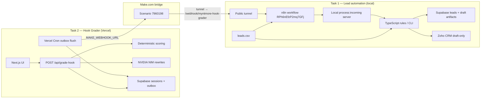

# Myntmore Systems & AI Automation Intern — Round 2

Two linked applications for lead follow-up automation and LinkedIn hook grading, built for the Myntmore Systems & AI Automation Intern Round 2 assignment.

[](https://myntmore-linkedin-hook-grader.vercel.app)
[](https://www.loom.com/share/39ce810ae73d4f318bd3fbf4691f0bc3)
[](#e-tech-stack)
[](#h-testing--verification)

> **Live product URL** = the deployed Hook Grader app (you can submit a hook in the browser).  
> **Walkthrough URL** = the Loom recording (narrated demo of both tasks). They are different links.

## Table of contents

- [A. Introduction](#a-introduction)
- [B. Verified highlights](#b-verified-highlights)
- [C. Live demo and Loom](#c-live-demo-and-loom)
- [D. Architecture](#d-architecture)
- [E. Tech stack](#e-tech-stack)
- [F. Features](#f-features)
- [G. Setup](#g-setup)
- [H. Testing and verification](#h-testing--verification)
- [I. Deployment](#i-deployment)
- [J. Limitations](#j-limitations)
- [K. Engineering decisions](#k-engineering-decisions)
- [L. Repository layout](#l-repository-layout)
- [M. Assignment deliverables](#m-assignment-deliverables)
- [N. Closing](#n-closing)

---

## A. Introduction

This repository implements both Round 2 tasks:

| Task | Directory | Role |
|------|-----------|------|
| **Task 1** — Lead follow-up | [`automation/`](./automation/) | Import messy leads, clean, qualify against Myntmore’s seven services, score, route Hot/Warm/Not a fit, draft follow-up emails (never auto-send), persist, and sync to Zoho CRM draft-only when configured |
| **Task 2** — LinkedIn Hook Grader | [`linkedin-hook-grader/`](./linkedin-hook-grader/) | Deterministic hook scoring (0–100), three AI rewrites, Supabase session + outbox, durable delivery to Make.com |

**Orchestration rules (assignment-accurate):**

- **n8n** is the Task 1 workflow orchestrator (local workflow `RPh6nEfzP2mq7GFj`).
- **Make.com** is the mandatory Task 2 → Task 1 bridge (scenario `7960198`). Hook Grader does not call n8n directly.
- Supporting TypeScript under `automation/src/` mirrors rules for unit tests and a CSV dry-run CLI — a CLI-only pipeline is not the submitted Task 1 runtime.

---

## B. Verified highlights

Re-checked in this documentation pass (2026-10-17) unless noted:

| Claim | Result |
|-------|--------|
| `leads.csv` fictional sample (20 rows, `.example` domains) | Present and tracked in Git |
| CSV dry-run routing | **Hot 12 / Warm 2 / Not a fit 6** (20/20 accounted) |
| Hook Grader unit tests | **108/108** passed |
| Automation unit tests | **56/57** passed (1 failure: Zoho Notes-mode fallback expectation) |
| Hook Grader lint + production build | Passed |
| Live Hook Grader HTTP | `https://myntmore-linkedin-hook-grader.vercel.app` → **200** |
| Loom share page HTTP | `https://www.loom.com/share/39ce810ae73d4f318bd3fbf4691f0bc3` → **200** |
| Make.com bridge (documented E2E) | Controlled run recorded 2026-10-15 — see [`docs/MAKE_BRIDGE_STATUS.md`](./docs/MAKE_BRIDGE_STATUS.md) |
| Native Zoho email draft (OAuth refresh token) | Live-tested path documented in [`automation/docs/ZOHO_DRAFT_CAPABILITY.md`](./automation/docs/ZOHO_DRAFT_CAPABILITY.md); emails never auto-sent |

---

## C. Live demo and Loom

| Kind | URL | Notes |
|------|-----|--------|
| **Live Hook Grader** | [myntmore-linkedin-hook-grader.vercel.app](https://myntmore-linkedin-hook-grader.vercel.app) | Deployed Task 2 app (network-checked HTTP 200 on 2026-10-17) |
| **Loom walkthrough** | [loom.com/share/39ce810ae73d4f…](https://www.loom.com/share/39ce810ae73d4f318bd3fbf4691f0bc3) | Narrated demo (share page HTTP 200 on 2026-10-17) |

Task 1 (n8n + local bridge) runs on a developer machine with a public tunnel for Make → n8n. It is not a separate public SaaS URL.

---

## D. Architecture

Only components that exist in this submission:



End-to-end Hook Grader path: grade → Supabase session + outbox → Make webhook → tunnel → n8n → local bridge → qualify/score/route/draft → Supabase / Zoho (draft-only).

---

## E. Tech stack

| Purpose | Technology |
|---------|------------|
| Hook Grader UI + API | Next.js 14, React 18, TypeScript, Tailwind CSS |
| Deterministic scoring | Pure TypeScript rules (`linkedin-hook-grader/lib/scoring`) |
| AI rewrites / email drafts | NVIDIA NIM (`meta/llama-3.2-11b-vision-instruct`); Gemini abandoned after observed 404/quota — [`docs/AI_PROVIDER_FAILURES.md`](./docs/AI_PROVIDER_FAILURES.md) |
| Persistence | Supabase (Postgres + RPC for atomic session/outbox) |
| Task 2 hosting | Vercel (`linkedin-hook-grader/` as project root) |
| Task 1 orchestration | n8n (local) |
| Task 2 → Task 1 bridge | Make.com (mandatory) |
| CRM drafts | Zoho CRM + native `__email_drafts` when OAuth configured; never `sendMail` |
| Tests | Vitest (both apps); Playwright e2e present for Hook Grader |
| Validation | Zod |

---

## F. Features

### Task 2 — LinkedIn Hook Grader

**In plain English:** Paste a LinkedIn post hook with your contact details. The app scores the hook with fixed rules (not the AI), suggests three stronger rewrites, saves the session, and queues a durable webhook so Task 1 can treat you as a lead.

**Technical:** Six weighted rules → score 0–100; NVIDIA returns exactly three validated rewrites (or labelled fallback); atomic Supabase RPC inserts session + `webhook_outbox`; Vercel Cron drains the outbox to Make.com with `idempotency_key = hook_grader_<session_id>`.

### Task 1 — Lead follow-up

**In plain English:** Twenty messy fictional leads are cleaned, matched to Myntmore services, scored, and sorted into Hot / Warm / Not a fit. Hot and Warm get a draft follow-up email (JSON artifact + Zoho draft when live). Nothing is auto-sent.

**Technical:** n8n orchestrates; TypeScript engine handles clean → qualify (seven services, `service_rubric_v1`) → score → route → draft → Supabase upsert → Zoho draft-only. Make ingest uses the same pipeline via `processIncomingLead` / `npm run process:incoming:server`.

### Bridge

Hook Grader outbox → Make Custom Webhook → HTTP forward to public tunnel → n8n webhook `/webhook/myntmore-hook-grader`. Tunnel hostnames are temporary; Make must be updated when the tunnel changes — [`docs/MAKE_BRIDGE_STATUS.md`](./docs/MAKE_BRIDGE_STATUS.md).

---

## G. Setup

Prerequisites: Node.js ≥ 20, npm, and (for Task 1 live path) local n8n plus a public tunnel.

### Task 2 — Hook Grader

```bash
cd linkedin-hook-grader
npm install
cp .env.example .env.local   # fill Supabase, NVIDIA, Make, cron secrets
npm run dev                  # http://localhost:3000
npm test
npm run lint
npm run build
```

Env placeholders: [`linkedin-hook-grader/.env.example`](./linkedin-hook-grader/.env.example). Never commit `.env.local`.

### Task 1 — Automation

```bash
cd automation
npm install
cp .env.example .env.local   # NVIDIA optional (template fallback without it)
npm test
npm run typecheck            # currently reports a known duplicate export — see Limitations
PIPELINE_MODE=dry_run npm run process:csv
```

Useful scripts:

| Script | Purpose |
|--------|---------|
| `npm run process:csv` | CSV dry-run / live pipeline against root `leads.csv` |
| `npm run process:incoming:server` | Local HTTP bridge for n8n Make ingest |
| `npm run print:n8n-ingest-url` | Print Make → n8n URL from env |
| `npm run zoho:draft` | Controlled Zoho draft helper |

Env placeholders: [`automation/.env.example`](./automation/.env.example).

### Shared database

SQL migrations live in [`supabase/migrations/`](./supabase/). Apply in Supabase SQL editor in order when credentials allow. Details: [`docs/SUPABASE_STATUS.md`](./docs/SUPABASE_STATUS.md), [`automation/docs/SCHEMA_PROPOSAL.md`](./automation/docs/SCHEMA_PROPOSAL.md).

---

## H. Testing and verification

### Latest local runs (2026-10-17)

| Suite | Command | Result |
|-------|---------|--------|
| Hook Grader unit | `cd linkedin-hook-grader && npm test` | **108/108** passed |
| Hook Grader lint | `cd linkedin-hook-grader && npm run lint` | Clean |
| Hook Grader build | `cd linkedin-hook-grader && npm run build` | Succeeded |
| Automation unit | `cd automation && npm test` | **56/57** passed — fail: `still supports qualification Notes mode as fallback` |
| Automation typecheck / build | `npm run typecheck` / `npm run build` | Fail: duplicate `processIncomingLead` export in `src/index.ts` |
| CSV dry-run | `PIPELINE_MODE=dry_run npm run process:csv` | 20/20; **Hot=12 Warm=2 Not a fit=6**; 14 draft artifacts; 0 sends |

Older docs that cite “75/75” or “36/36” are outdated; use the counts above.

### Integration evidence (not re-run in this docs pass)

- Make → n8n → Supabase → Zoho Description / draft path: [`docs/MAKE_BRIDGE_STATUS.md`](./docs/MAKE_BRIDGE_STATUS.md), [`automation/docs/ZOHO_DRAFT_CAPABILITY.md`](./automation/docs/ZOHO_DRAFT_CAPABILITY.md)
- n8n CSV execution example: [`automation/workflows/n8n-lead-followup.md`](./automation/workflows/n8n-lead-followup.md)

---

## I. Deployment

| Component | Status |
|-----------|--------|
| Hook Grader on Vercel | **Deployed** at the live URL above (project root = `linkedin-hook-grader/`) |
| Vercel Cron outbox | Configured in `vercel.json` as daily Hobby schedule `0 12 * * *` (not every minute) |
| Task 1 n8n | **Local** — not claimed as a public cloud deploy |
| Make.com scenario | Cloud scenario `7960198`; depends on a reachable tunnel to local n8n |

---

## J. Limitations

1. **Emails never auto-send.** Zoho `sendMail` / send endpoints are intentionally unused.
2. **Zoho native drafts** require `PIPELINE_MODE=live`, OAuth refresh credentials, and `npm run process:incoming:server` when the Make → n8n path should create drafts. See [`automation/docs/ZOHO_DRAFT_CAPABILITY.md`](./automation/docs/ZOHO_DRAFT_CAPABILITY.md). Without that stack, qualification may still land on the CRM Lead Description / JSON artifacts only.
3. **Make → n8n tunnel** hostnames change when Cloudflare Quick Tunnel / localtunnel restarts; Make’s forward URL must be updated manually.
4. **Hobby Cron** retries outbox at most once per day unless upgraded — immediate delivery relies on in-request flush where implemented.
5. **Automation typecheck** currently fails on a duplicate export; unit tests still run via Vitest/tsx.
6. **One automation unit test** for Zoho Notes-mode fallback is failing as of 2026-10-17.
7. **Gemini** is not used in production paths after observed API failures.

---

## K. Engineering decisions

| Decision | Why |
|----------|-----|
| Deterministic scoring in code | Score must be explainable and stable; AI only rewrites |
| Outbox + cron for Make | Webhook delivery survives request failures |
| Make.com for Task 2→1 | Assignment-mandated; not replaced by n8n-only or shared imports |
| n8n for Task 1 runtime | Satisfies automation-platform requirement; TS keeps rules testable |
| NVIDIA after Gemini failure | Observed Gemini 404/quota; NVIDIA model live-tested for structured JSON |
| Draft-only Zoho | Safe demo: no accidental outreach to real or sample contacts |
| Idempotency keys | `csv_<lead_id>` / `hook_grader_<session_id>` prevent duplicate drafts on retry |

**Future improvements (not implemented here):** minute-level cron or queue worker; harden Notes fallback test; fix `src/index.ts` duplicate export; persistent tunnel or hosted n8n for always-on Make→Task1.

---

## L. Repository layout

```
myntmore-assignment/
├── README.md                      # This showcase
├── AGENTS.md                      # Agent ownership boundaries
├── leads.csv                      # Fictional Task 1 sample (20 rows, committed)
├── .gitignore
├── docs/                          # Assignment-wide docs (index below)
│   ├── README.md
│   ├── MAKE_BRIDGE_STATUS.md
│   ├── AGENT_HANDOFF.md
│   ├── AI_PROVIDER_FAILURES.md
│   └── …
├── linkedin-hook-grader/          # Task 2 — Next.js app
│   ├── app/                       # UI + API routes
│   ├── components/
│   ├── lib/                       # scoring, NVIDIA client, supabase, webhook
│   ├── docs/
│   ├── e2e/
│   └── vercel.json
├── automation/                    # Task 1 — n8n + TypeScript engine
│   ├── src/
│   ├── tests/
│   ├── workflows/                 # n8n workflow + engine JS
│   ├── docs/
│   └── schemas/
└── supabase/
    └── migrations/                # Shared SQL migrations
```

Docs index: [`docs/README.md`](./docs/README.md).

---

## M. Assignment deliverables

| Deliverable | Location / link |
|-------------|-----------------|
| Task 1 automation | `automation/` + n8n workflow `RPh6nEfzP2mq7GFj` |
| Task 2 Hook Grader | `linkedin-hook-grader/` |
| Sample leads | `leads.csv` (fictional, public) |
| Live URL | https://myntmore-linkedin-hook-grader.vercel.app |
| Loom | https://www.loom.com/share/39ce810ae73d4f318bd3fbf4691f0bc3 |
| GitHub | https://github.com/Gaurav8302/Myntmore-Linkdin-HookGrader |
| Make.com bridge | Scenario `7960198` — docs in `docs/MAKE_BRIDGE_STATUS.md` |
| Ops / acceptance notes | `docs/ACCEPTANCE_CRITERIA.md`, `docs/ASSIGNMENT_ANALYSIS.md` |

---

## N. Closing

This submission pairs a production-deployed Hook Grader with a local n8n lead engine and a Make.com bridge, with deterministic scoring, durable webhooks, and draft-only CRM behaviour. Figures and test counts in this README match the 2026-10-17 verification pass; integration details that were not re-executed here are linked to the dated evidence docs rather than restated as new claims.

For agent collaboration rules, see [`AGENTS.md`](./AGENTS.md). For deeper ops, start at [`docs/README.md`](./docs/README.md).
